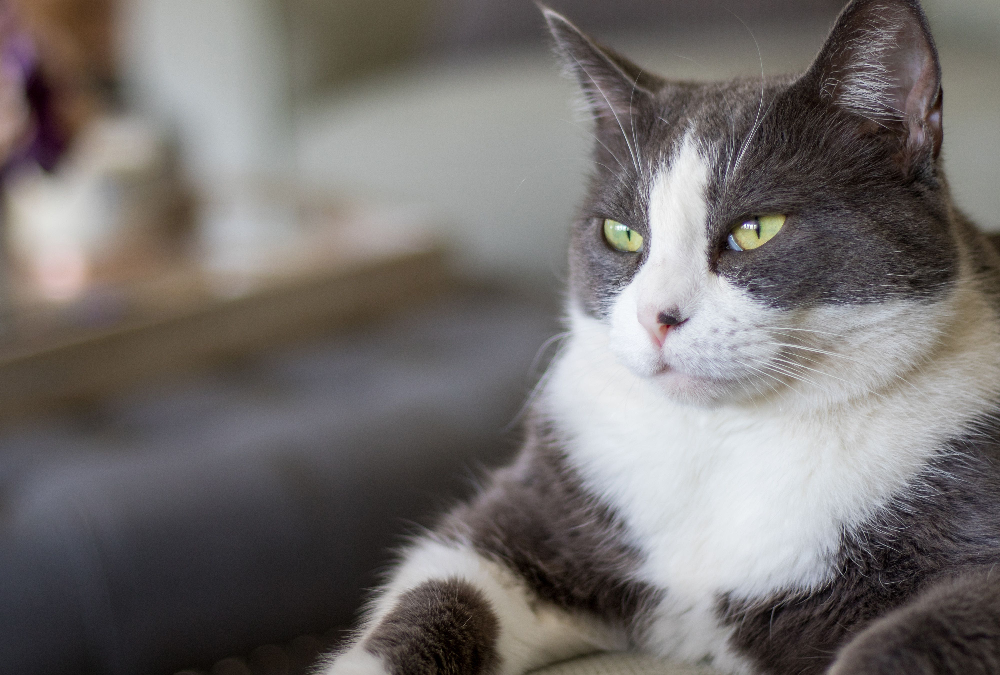

# Introduction
Hi! I'm Cynthia Ong Ka, a student from Software Engineering Department, University Malaya. I'm taking the Software Maintenance and Evolution course.
I expect to learn a lot about modern software maintenance practices and how to work with legacy systems.
- **Fun fact**: I love listening to podcast in my free time.
- **Course expectations**: To master techniques for maximizing software longevity and keeping systems maintainable over time.

